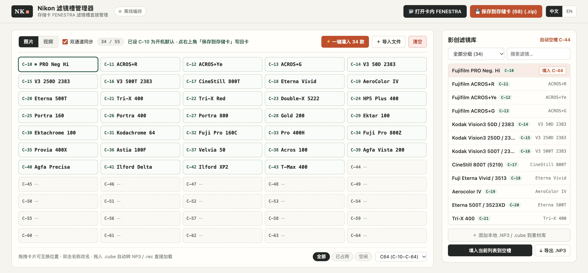
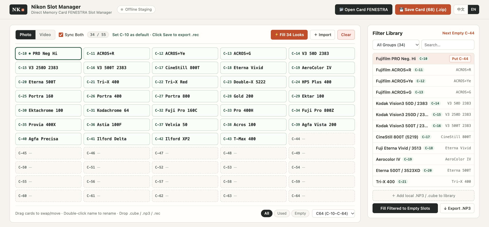

# Nikon Slot Manager

**[简体中文](#zh) · [English](#en) · [在线使用 / Live Demo ↗](https://ycx81.github.io/nikon-slot-manager/)**

---

## 简体中文

面向支持 **Fenestra** 扩展优化校准槽（`C-10`～`C-64` / `C32`，存储卡 `FENESTRA/scXXXXXXXX.rec`）的尼康相机打造的单文件、全平台、零安装网页管理工具。

无需任何 USB 驱动、桥接程序或命令行：可直接点击 **[在线打开（GitHub Pages）↗](https://ycx81.github.io/nikon-slot-manager/)** 使用，也可下载单个文件 [`Nikon-Slot-Manager.html`](./Nikon-Slot-Manager.html) 在 **macOS / Windows / Linux** 本地离线打开（所有滤镜与存储卡读写 100% 在浏览器本地完成，不上传任何文件；右上角支持 **中文 / EN** 切换）。

> **当前已实机验证机型**：Nikon Z8（固件 C 3.11 + Fenestra `slotcard.wlm` C32 / C64）。界面与数据结构按通用尼康机型设计，便于后续适配更多支持 Fenestra 的机身。

### 核心特性

* **直连存储卡实时读写（零安装、零弹窗扫照片）**：使用 Chrome / Edge（在线打开或本地双击 `file://` 均可）点击右上角 **「📂 打开卡内 FENESTRA」**，直接选中存储卡里的 **`FENESTRA` 子文件夹**，即可实时读取当前所有槽位，所有新增、替换、改名、换位、删除都会自动安全追加写入 `scXXXXXXXX.rec`（不扫描 `DCIM/` 照片目录）。
* **全平台离线兜底**：在 Safari、Firefox 或移动设备上打开时自动切换为只读加载 + 离线编排模式，编辑完成后点 **「💾 保存到存储卡 (.zip)」** 导出新增的 `scXXXXXXXX.rec`，复制到卡内 `FENESTRA/` 即可生效。
* **一屏管理全部 55 个扩展槽（`C-10`～`C-64`）**：
  * 5 列紧凑胶囊矩阵，同屏查看全部照片 / 视频通道槽位，支持 **双通道同步** 或分通道独立管理，可切换 **C64 / C32** 容量上限。
  * **行内快捷操作**：设开机默认（`★`）、改名（`✎` 或直接双击名称，1–19 个 ASCII 字符）、拖拽卡片互换位置（或点击 `⇄` 移动/复制/互换）、清空/删除（`×`，自动写入同步索引，断电重启不复活）。
* **内置 34 款 MIT 开源胶片预设 + 本地 `.NP3` / `.cube` 直拖**：
  * 支持 **「⚡ 一键灌入 34 款」** 或 **「填入当前列表到空槽」**（自动跳过已有滤镜，保留原槽位），附带逐批写入进度动画与写卡状态提示。
  * 直接把本地 `.NP3` 或 `.cube` 3D LUT 拖到任意槽位或右侧素材库，`.cube` 会在浏览器本地自动拟合转换为 Nikon Flexible Color `0310` `.NP3` 后写入槽位（由同源项目 [`lut-to-np3`](https://github.com/YCX81/lut-to-np3) 拟合引擎驱动）。
* **标准 `.NP3` 打包导出**：点击右下角 **「↓ 导出 .NP3」** 可将卡中已有或当前筛选的滤镜一键打包为标准 `NIKON/CUSTOMPC/PICCON01.NP3`～`PICCON99.NP3` + `SLOT-MAP.txt`，兼容尼康工坊（NX Studio）及支持 Flexible Color 的原厂尼康机身。

### 使用方法

1. 在线打开 **[https://ycx81.github.io/nikon-slot-manager/](https://ycx81.github.io/nikon-slot-manager/)**，或下载 [`Nikon-Slot-Manager.html`](./Nikon-Slot-Manager.html) 用 Chrome / Edge 双击打开。
2. 将相机存储卡插入电脑读卡器，点击右上角 **「📂 打开卡内 FENESTRA」**，**点进存储卡里的 `FENESTRA` 文件夹后确认**（请勿选整张存储卡根目录）。
3. 编排滤镜槽：
   * 保留原有滤镜并批量补齐：点右下角 **「填入当前列表到空槽」**；
   * 从 `C-10` 起一键覆盖灌入：点 **「⚡ 一键灌入 34 款」**；
   * 导入自定义风格：直接将 `.NP3` 或 `.cube` 文件拖入左侧任意槽位。
4. Chrome / Edge 直连模式下每次改动已自动落盘（顶部绿色徽章显示最新 `head` 代数）；安全弹出存储卡、插回相机开机，即可在照片／视频的「设定优化校准」中直接使用。

> **双卡槽机身提示（如 Nikon Z8）**：若机身同时插着 CFexpress（A 槽）与 SD 卡（B 槽），且两张卡上都存在 `FENESTRA/` 目录，相机开机时会优先加载 **A 槽（CFexpress）** 的 `FENESTRA/`；请对实际生效的那张卡进行编辑。

### 内置开源预设（34 款 · 全部 MIT 许可）

| 分类 | 预设列表 |
| :--- | :--- |
| **Fujifilm 开源模拟（4）** | PRO Neg. Hi、ACROS+R、ACROS+Ye、ACROS+G |
| **电影胶片与印片（5）** | Kodak Vision3 50D / 2383、Vision3 250D / 2383、Vision3 500T / 2383、CineStill 800T (5219)、Fuji Eterna Vivid / 3513 |
| **GRKit 同源配方（6）** | Kodak Aerocolor IV、Fuji Eterna 500T / 3523XD、Kodak Tri-X 400、Tri-X 红滤镜、Eastman Double-X 5222、Ilford HP5 Plus 400 |
| **经典胶卷精选（19）** | Portra 160、Portra 400、Portra 800、Gold 200、Ektar 100、Ektachrome E100D、Kodachrome 64、Fuji Pro 160C、Pro 400H、Fuji Pro 800Z、Provia 400X、Astia 100F、Velvia 50、Acros 100、Agfa Vista 200、Agfa Precisa 100、Kodak T-Max 400、Ilford Delta 100、Ilford XP2 |

#### 更多厂商官方 LUT（可自行下载后直接拖入）

出于厂商授权条款限制，本公开版未内置富士官方与理光官方专有 LUT 文件；你可从以下官方页面自行获取后直接拖入本工具（或先用配套的 [`LUT → NP3`](https://ycx81.github.io/lut-to-np3/) 预览微调并导出 `.NP3` 后再拖入槽位）：

* **Fujifilm 官方 LUT 下载页**：https://www.fujifilm-x.com/global/support/download/lut/
* **Ricoh GR 图像控制官方说明**：https://www.ricoh-imaging.co.jp/english/products/gr-3/feature/03/

### 开源许可与致谢

本项目基于 **MIT License** 开源，并使用了以下 MIT 许可开源项目（完整许可文本亦内嵌于 `Nikon-Slot-Manager.html` 中的 `#third-party-license` 区块）：

* [`lut-to-np3`](https://github.com/YCX81/lut-to-np3) — 本地 `.cube` → Nikon Flexible Color `.NP3` 拟合引擎与离线模型。
* [`nikon-flexible-color-picture-control`](https://github.com/tomikawa/nikon-flexible-color-picture-control) — Copyright (c) 2025 TOMIKAWA Sotaro (**MIT**)。
* [`spectral_film_lut`](https://github.com/JanLohse/spectral_film_lut) — Copyright (c) Jan Lohse (**MIT**)。
* [`GRKit`](https://github.com/ahonn/GRKit) — Copyright (c) ahonn (**MIT**)。
* [`t3mujinpack`](https://github.com/t3mujinpack/t3mujinpack) — Copyright (c) João Almeida (**MIT**)。
* [`Film-Luts`](https://github.com/YahiaAngelo/Film-Luts) — Copyright (c) Yahia Angelo (**MIT**)。

---

## English

A single-file, zero-install, cross-platform browser tool for managing **Fenestra** extended Custom Picture Control slots (`C-10`–`C-64` / `C32`, memory card `FENESTRA/scXXXXXXXX.rec`) on Nikon cameras.

No USB drivers, bridge daemons, or CLI required: launch directly via **[GitHub Pages (Live Web App) ↗](https://ycx81.github.io/nikon-slot-manager/)**, or download the single self-contained file [`Nikon-Slot-Manager.html`](./Nikon-Slot-Manager.html) to run completely offline on **macOS, Windows, or Linux** (100% local processing, nothing is ever uploaded; switch **中文 / EN** in the top-right corner).

> **Hardware Verified On**: Nikon Z8 (FW C 3.11 + Fenestra `slotcard.wlm` C32 / C64). The UI and packaging are designed to be model-agnostic for future Nikon camera support.

### Key Features

* **Direct Memory Card Live R/W (Zero Install, Never Scans `DCIM/`)**: In Chrome or Edge (both on GitHub Pages and local `file://`), click **📂 Open Card FENESTRA** and pick the **`FENESTRA`** subfolder on your memory card to read existing slots and write changes directly to `scXXXXXXXX.rec` in real time.
* **Universal Cross-Browser Fallback**: On Safari, Firefox, or mobile devices, loads card data in read-only mode and exports the new `scXXXXXXXX.rec` generation file(s) via **💾 Save to Card (.zip)** — simply copy them into `FENESTRA/` on your card.
* **All 55 Extended Slots (`C-10`–`C-64`) on One Screen**:
  * Compact 5-column pill grid for Photo & Video banks with **Sync Both** or independent per-bank editing, plus **C64 / C32** slot capacity selector.
  * **Inline Micro-Actions**: Set boot default (`★`), double-click or click `✎` to rename (`1–19` ASCII chars), drag-and-drop cards to swap (or click `⇄` to move/copy/swap), and delete (`×`, updates the `sc*.rec` generation index cleanly).
* **34 Built-in MIT-Licensed Film Presets + Local `.NP3` / `.cube` Drop-In**:
  * Click **⚡ Fill 34 Looks** or **Fill Filtered to Empty Slots** (preserves existing slots automatically) with smooth animated staging & card-write progress feedback.
  * Drop any local `.NP3` or `.cube` 3D LUT onto any slot or the library panel — `.cube` LUTs are automatically fitted into Nikon Flexible Color `0310` `.NP3` locally in the browser (powered by [`lut-to-np3`](https://github.com/YCX81/lut-to-np3)).
* **Standard `.NP3` Pack Export**: Click **↓ Export .NP3** to export active slots or filtered library items as standard `NIKON/CUSTOMPC/PICCON01.NP3`–`PICCON99.NP3` + `SLOT-MAP.txt`, compatible with **Nikon NX Studio** and stock Flexible Color Nikon bodies.

### Quick Start

1. Open **[https://ycx81.github.io/nikon-slot-manager/](https://ycx81.github.io/nikon-slot-manager/)** or download [`Nikon-Slot-Manager.html`](./Nikon-Slot-Manager.html) and open it in Chrome or Edge.
2. Insert your camera memory card into a card reader, click **📂 Open Card FENESTRA**, and select the **`FENESTRA`** subfolder inside the card *(do not pick the drive root)*.
3. Organize your slots:
   * Keep existing custom slots and append presets: click **Fill Filtered to Empty Slots**;
   * Batch fill from `C-10`: click **⚡ Fill 34 Looks**;
   * Add your own looks: drag `.NP3` or `.cube` files directly onto any slot.
4. In Chrome / Edge live R/W mode, every edit is flushed automatically (the green header pill tracks the active `head` generation). Safely eject the card, insert it into your camera, and power on.

> **Dual-Slot Camera Note (e.g., Nikon Z8)**: When both CFexpress (Slot A) and SD (Slot B) cards are inserted and both contain a `FENESTRA/` folder, the camera prioritizes **Slot A (CFexpress)** at boot. Make sure you edit the `FENESTRA/` folder on the card your camera boots from.

### Built-in Presets (34 · All MIT-Licensed)

| Category | Presets |
| :--- | :--- |
| **Fujifilm Open-Source Looks (4)** | PRO Neg. Hi, ACROS+R, ACROS+Ye, ACROS+G |
| **Cinema & Print Film (5)** | Kodak Vision3 50D / 2383, Vision3 250D / 2383, Vision3 500T / 2383, CineStill 800T (5219), Fuji Eterna Vivid / 3513 |
| **GRKit Film Recipes (6)** | Kodak Aerocolor IV, Fuji Eterna 500T / 3523XD, Kodak Tri-X 400, Tri-X / Red Filter, Eastman Double-X 5222, Ilford HP5 Plus 400 |
| **Classic Film Stocks (19)** | Portra 160, Portra 400, Portra 800, Gold 200, Ektar 100, Ektachrome E100D, Kodachrome 64, Fuji Pro 160C, Pro 400H, Fuji Pro 800Z, Provia 400X, Astia 100F, Velvia 50, Acros 100, Agfa Vista 200, Agfa Precisa 100, Kodak T-Max 400, Ilford Delta 100, Ilford XP2 |

#### Official Vendor LUTs (Download Separately)

To respect vendor licensing terms, proprietary Fujifilm and Ricoh LUT files are not bundled in this public distribution. You can download official `.cube` LUTs from the vendors and drop them directly into Nikon Slot Manager (or fine-tune and preview them first in [`LUT → NP3`](https://ycx81.github.io/lut-to-np3/)):

* **Fujifilm Official LUT Downloads**: https://www.fujifilm-x.com/global/support/download/lut/
* **Ricoh GR Image Control Reference**: https://www.ricoh-imaging.co.jp/english/products/gr-3/feature/03/

### License & Third-Party Attributions

Released under the **MIT License**. This project incorporates and complies with the following MIT-licensed projects (full license texts are also embedded inside `Nikon-Slot-Manager.html` under `#third-party-license`):

* [`lut-to-np3`](https://github.com/YCX81/lut-to-np3) — Local `.cube` → Nikon Flexible Color `.NP3` fitting engine.
* [`nikon-flexible-color-picture-control`](https://github.com/tomikawa/nikon-flexible-color-picture-control) — Copyright (c) 2025 TOMIKAWA Sotaro (**MIT**).
* [`spectral_film_lut`](https://github.com/JanLohse/spectral_film_lut) — Copyright (c) Jan Lohse (**MIT**).
* [`GRKit`](https://github.com/ahonn/GRKit) — Copyright (c) ahonn (**MIT**).
* [`t3mujinpack`](https://github.com/t3mujinpack/t3mujinpack) — Copyright (c) João Almeida (**MIT**).
* [`Film-Luts`](https://github.com/YahiaAngelo/Film-Luts) — Copyright (c) Yahia Angelo (**MIT**).
